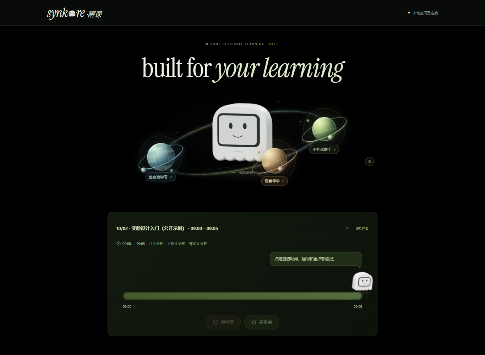

# 醒客 · Synkore

把个人学习 Agent 和一只桌面小幽灵连接起来：网页负责课程资料、检索、问答和讲解，NiceMCU T5 开发板负责桌宠互动、录音标记和伴学提示。

**在线体验：[醒客公开演示](https://xingke-synkore-demo.bainuoxi717.chatgpt.site)** · [直接进入五分钟随堂伴学](https://xingke-synkore-demo.bainuoxi717.chatgpt.site/replay-demo)

公开演示无需登录，提供示例问答、换个讲法、信息流互动与五分钟伴学。问答和讲解为预设内容，不调用在线模型；互动只保存在当前浏览器。完整本地版按下方步骤运行，可使用自己的课程、服务配置与开发板。

> 网站中的品牌字样为「synkore·醒课」。这是作品的公开源码归档；没有包含私人课程、账号登录态、API 密钥或克隆音色。



## 已实现

- **学习空间**：可拖动的 3D 小幽灵、三个星球入口、课程时间线、重点和疑问标记。
- **学习问答**：选择具体课次，依据字幕和资料回答，保留课程出处；同一份资料可以「换个讲法」。
- **个性化讲解**：人物检索、资料补充、最多 20 篇材料的自动调研、讲解方法蒸馏和保存；内置方法保留上游来源与许可。
- **信息流学习**：把课程薄弱点组织为知识帖、延伸阅读和讨论。
- **语音**：系统朗读，以及用户自行配置、获得授权的音色合成；公开包不提供任何真人音色。
- **T5 桌宠与录音**：16 种表情、48 句预设台词，点击身体换表情；横屏录音、标记疑问、TF 卡保存、读卡器导入；BOOT 开关屏幕。
- **五分钟随堂伴学**：回放进度同步网页与开发板，覆盖回答、评论、重点、提问、材料、术语和旧知识关联。

五分钟演示使用**提前编写的示例课程和卡片**，按播放时间触发；不是实时识别、实时搜索或在线模型推理。真实课堂回放曾在本机与实板验证，因课程隐私与素材权限未公开。

## 启动网站

需要 **Node.js 24+、npm**。在仓库根目录执行：

```bash
npm ci
npm run seed
npm run build
npm start
```

打开 [http://localhost:3930](http://localhost:3930)。Windows 也可双击 `启动网站.cmd`。`seed` 只添加两个明确标为示例的课次，重复执行不会覆盖已有记录。

如需 AI 问答和人物研究，把 `.env.example` 复制为 `.env`，填入自己的服务密钥，或在网页设置中配置。密钥写入本地 SQLite，不能提交到 Git。未配置服务时仍可查看界面、课程、桌宠和预分析回放。主动调用外部 AI 服务会按提供商规则计费。

开发前端可执行 `npm run dev`；同时运行后端 `npm start`，Vite 的 API 代理默认指向 3930。

## 启动随堂伴学

需要 Python 3.12+；示例视频已随仓库提供，无需学校账号。

```bash
python -m venv .venv
# Windows:
.venv\Scripts\python -m pip install -r replay-demo/requirements.txt
.venv\Scripts\python replay-demo/bridge.py
# macOS / Linux: 使用 .venv/bin/python
```

保持网站运行，打开 [五分钟随堂伴学](http://localhost:3930/replay-demo)。没有开发板也能看视频、字幕、卡片和屏幕预览；接入开发板后选择正确的 COM 口并连接。

桥接服务在本机 8771 端口。中文屏幕图卡优先使用 `SYNKORE_FONT`，其次查找系统中文字体。Linux 可安装 `fonts-noto-cjk`；详情见 [伴学演示](replay-demo/README.md)。

## 开发板与录音导入

固件、可烧录镜像、板级适配、串口协议和 Python 导入网页位于 [`device/`](device/README.md)。当前硬件为 **NiceMCU T5 V1.2，2.8 英寸触屏，320×240 横屏**。USB 在左；装壳布局将内容中心左移，为右侧留白。

公开仓库保留已实板测试的整合固件 QIO 镜像及 SHA-256。不会自动烧录或格式化 TF 卡。完整 Flash 备份可能包含设备信息，未公开。SDK、编译工具和语音模型通过官方渠道另行安装，不把本机缓存放入仓库。

## 目录

| 目录 | 内容 |
| --- | --- |
| `web/` | React、Vite、Three.js 前端与自托管素材 |
| `server/` | Express、SQLite、课程问答、资料检索、人物方法与语音接口 |
| `device/firmware/` | 桌宠、录音及整合版 Arduino 固件 |
| `device/app/` | 录音导入、ASR、学习流 Python 服务 |
| `device/prebuilt/` | 已验证的整合版固件及构建摘要 |
| `replay-demo/` | USB 图卡桥接与五分钟示例 |
| `examples/` | 人工编写的公开示例资料 |
| `docs/` | 架构、硬件、素材来源与公开范围 |

## 验证

```bash
npm test
npm run build
npm run audit:public
# 可选浏览器测试：
npx playwright install chromium
npm run test:browser
```

也可设置 `SYNKORE_BROWSER_CHANNEL=chrome`，使用本机已安装的 Chrome 运行浏览器测试。

公开演示的静态构建：`npm run build:public`，输出 `web/dist/`。可执行 `node scripts/test-public-site.mjs web` 验证示例交互与浏览器内数据隔离（需要 Chrome）。默认 `npm run build` 仍构建连接本地后端的完整网站。

上述自动测试使用隔离数据和模拟提供商，不调用收费模型。实板测试需要实际硬件，不能由 CI 代替。版本验证记录见 [VALIDATION.md](docs/VALIDATION.md)。

## 数据、部署与许可

这是**本地单用户应用**，默认只监听 `127.0.0.1`。公开仓库不等于把本地服务直接暴露到公网；对外部署前需要补充账号认证、访问控制、HTTPS 和密钥管理。Canvas / 校园系统的同步代码需要使用者自己的合法登录授权，不提供或绕过学校权限。

本仓库公开源代码用于查看与复现，项目自有部分尚未额外授予开源许可。第三方代码、字体与图片继续遵守各自许可；见 [THIRD_PARTY_NOTICES.md](THIRD_PARTY_NOTICES.md)。

公开范围和排除项见 [PUBLICATION.md](docs/PUBLICATION.md)。
