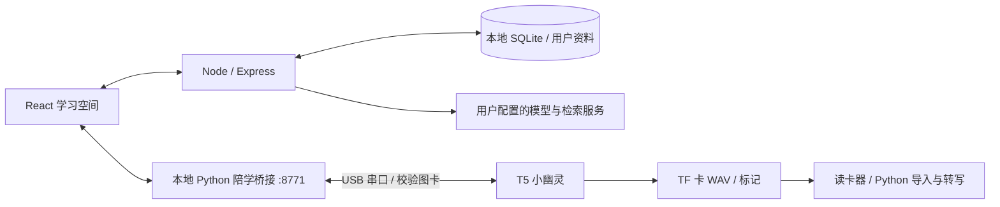

# 架构与运行边界

网站运行在电脑上；开发板不运行大语言模型。模型问答、课程资料检索和人物方法提取由电脑后端完成。桌宠动画和录音由开发板本地运行，可使用充电宝独立供电。

伴学演示把 256×160 单色图卡经 PackBits 压缩后分包传入开发板，CRC 校验完成后原子切换画面。小幽灵继续动画；固件会在录音、保存、导出期间拒绝远程图卡，避免竞争。

录音为 16kHz / 16-bit / 单声道 PCM WAV。每节课目录包含 `audio.wav`、`marks.json`、`meta.json`。停止保存后才能取卡或导入；课程编号自动分配，防止覆盖已有文件。

实时上课音频捕获、实时 ASR、开放式语音助手与在线实时搜索仍属于后续升级；公开演示按预分析时间轴运行。自定义人物功能提取讲解方法，不宣称人物本人正在作答。
